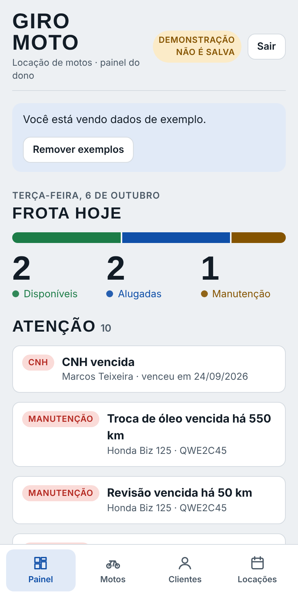
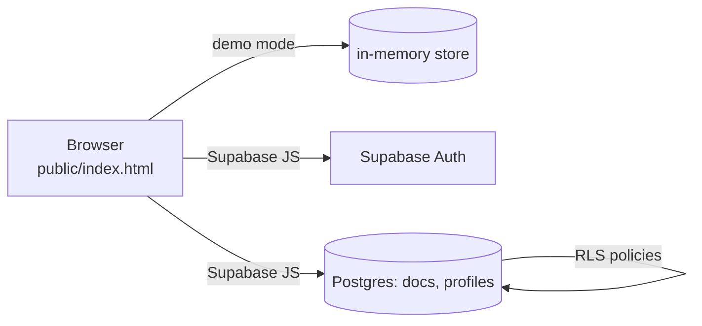

# Giro Moto

> 🇧🇷 [Leia em português](README.pt-BR.md)

Mobile-first management system for a small **motorcycle rental** business: an owner panel and a read-only customer view, in a **single static HTML file**. It runs fully in the browser in demo mode, or against a [Supabase](https://supabase.com) backend with real authentication and database-enforced access control.

<p>
  
  
  
  
  
</p>

**Live demo:** enable GitHub Pages (see below), then sign in with `demo` / `demo1234` (owner) or `rafael.moreira` / `demo1234` (customer). Demo data lives only in memory and is never saved.

## Features

- **Fleet** – bikes with status (available / rented / maintenance), plate, mileage, oil-change and service reminders.
- **Customers** – CPF (validated), RG, CNH expiry alerts, full address auto-filled from the CEP ([ViaCEP](https://viacep.com.br)), and attached ID documents (photos or small PDFs, visible to the owner only).
- **Weekly rentals** – fixed weekly price, due every Monday or Friday; payments are allocated to the oldest open instalment (FIFO).
- **Late fees** – configurable fine and daily interest are *suggested*, then posted by the owner as occurrences (nothing is charged silently). Security deposit tracking.
- **Pix** – static *copia-e-cola* payload generated client-side (EMV TLV + CRC16-CCITT) for phone, CPF/CNPJ, e-mail or random keys.
- **WhatsApp** – one-tap collection messages (with the Pix code) for the owner; contact buttons for the customer (`wa.me` links, no API cost).
- **Rental agreement** – editable template (fills in the renter's CPF, RG and address), customer acceptance, printable.
- **Inspection** – check-in/check-out with photos.
- **Maintenance & per-bike profit** – costs vs. revenue by motorcycle.
- **Customer logins** – created only by the owner; customers see **only their own** data: amount due and next due date at the top, weekly instalment statement (paid / open / late), late-fee explanation, deposit status, contract, inspection photos and Pix.
- **Backup export**, installable PWA, dark/light themes.

## Architecture



There is no build step and no framework. The app talks to a small store interface with interchangeable implementations (in-memory for demo, Supabase for production).

**Data model.** One generic table, `docs(col, id, data jsonb)`, holds every collection (`motos`, `clientes`, `locacoes`, `pagamentos`, …). Nested collections use path-like names such as `vistorias/<id>/fotos`. A second table, `profiles(user_id, role, cliente_id)`, maps each auth user to `admin` or `cliente`. This keeps the schema trivial to evolve; the trade-off is that queries filter on `data->>'field'` instead of typed columns.

## Security model

Authorization is enforced **in the database**, not in the UI:

- Row Level Security on `docs` and `profiles`; `anon` has no table access.
- Customers can read only rows tied to their own `cliente_id` (contract, payments, bike, inspection photos) plus the Pix and agreement config. They cannot write anything.
- Admin-only RPCs (`admin_set_password`, `admin_delete_user`) are `security definer`; the one-time `criar_primeiro_admin` refuses to run once an admin exists.
- Security-definer helpers avoid RLS recursion.
- Strict CSP in `public/_headers`.

These rules are covered by `tests/sql/rls.test.sql`.

## Run it

**Demo (no setup):**

```bash
npm run serve        # or: open public/index.html in a browser
```

**With Supabase:**

1. Create a free Supabase project. In *Authentication → Sign In / Providers*, turn **Confirm email** off.
2. Run [`sql/schema.sql`](sql/schema.sql) in the SQL editor.
3. Copy `public/config.example.js` to `public/config.js` and fill in your URL, publishable key and an e-mail you own (`EMAIL_BASE`; usernames become `you+username@domain`).
4. Update `connect-src` in `public/_headers` if your host honours it, deploy `public/` anywhere static (Netlify, Cloudflare Pages, GitHub Pages), open it and use **Primeiro acesso: criar administrador**.

**GitHub Pages demo:** *Settings → Pages → Source: GitHub Actions*. The included workflow publishes `public/` with an empty config, i.e. demo mode.

## Tests

```bash
npm test                      # 8 UI/logic flows, Node ≥ 18, no dependencies
PGHOST=localhost PGUSER=postgres bash tests/sql/run.sh   # RLS tests on a throw-away local Postgres
```

The UI flows run the real app script against an in-memory DOM and a fake Supabase client. The SQL test creates and drops its own database and refuses to run against Supabase hosts.

## Limitations and roadmap

- Pix payments are **confirmed manually**; automatic confirmation needs a payment provider and a server function.
- No GPS tracking, no automatic billing via WhatsApp API (links only).
- Photos are stored in the database; move to object storage for larger fleets.
- Free-tier Supabase has no automatic backups and pauses after inactivity (use the export button).
- Not yet exercised against a live Supabase from CI; the fake client and local Postgres cover the logic and the policies.
- UI is in Brazilian Portuguese; i18n is not implemented.

> **Legal notice.** The rental agreement template, fines and interest are examples only. Have a lawyer review them before use. This software is provided as is, without warranty.

## License

[MIT](LICENSE)
