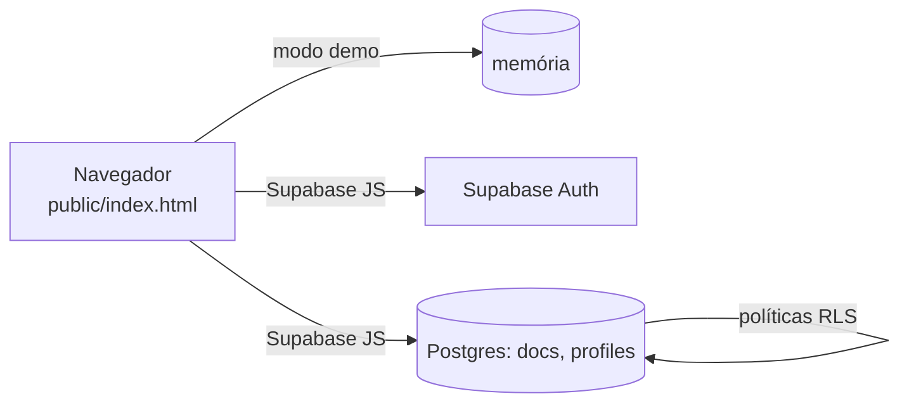

# Giro Moto

> 🇬🇧 [Read in English](README.en.md)

Sistema de gestão para **locação de motos**, pensado para o celular: painel do dono e visão do cliente em **um único arquivo HTML estático**. Roda inteiro no navegador em modo demonstração, ou com um backend [Supabase](https://supabase.com) (login real e controle de acesso feito pelo próprio banco de dados).

<p>
  
  
  
  
  
  
</p>

**Demonstração online:** ative o GitHub Pages (veja abaixo) e entre com `demo` / `demo1234` (dono) ou `rafael.moreira` / `demo1234` (cliente). Os dados de exemplo ficam só na memória do navegador e nunca são salvos.

## Recursos

- **Frota:** motos com status (disponível, alugada ou em manutenção), placa, km e lembretes de troca de óleo e revisão.
- **Clientes:** CPF (validado), RG, alerta de CNH vencendo, endereço preenchido automaticamente pelo CEP (via [ViaCEP](https://viacep.com.br)) e anexos de documentos (fotos ou PDFs pequenos, visíveis só ao dono).
- **Locação semanal:** valor fixo por semana, cobrança toda segunda ou sexta; os pagamentos quitam primeiro as parcelas mais antigas.
- **Multa e juros por atraso:** apenas *sugeridos*; o dono lança como ocorrência (nada é cobrado em silêncio). Controle de caução.
- **Pix:** código *copia e cola* gerado no próprio navegador (BR Code com CRC16) para chave de celular, CPF/CNPJ, e-mail ou aleatória.
- **WhatsApp:** mensagem de cobrança com o código Pix para o dono; botões de contato para o cliente (links `wa.me`, sem custo de API).
- **Termo de locação:** modelo editável (preenche CPF, RG e endereço do locatário), com aceite do cliente.
- **Vistoria:** entrega e devolução com fotos.
- **Manutenção e resultado por moto:** custos x receita.
- **Logins de cliente:** criados só pelo dono. O cliente vê **apenas** os próprios dados: valor devido e próximo vencimento no topo, extrato das parcelas semanais (paga, em aberto ou atrasada), explicação de multa e juros, caução, termo, vistorias com fotos e Pix.
- **Exportar backup**, PWA instalável, tema claro e escuro.

## Arquitetura



Não há etapa de build nem framework. O app conversa com uma pequena interface de armazenamento, com implementações intercambiáveis: memória (demonstração) e Supabase (produção).

**Modelo de dados.** Uma tabela genérica, `docs(col, id, data jsonb)`, guarda todas as coleções (`motos`, `clientes`, `locacoes`, `pagamentos`, …). Coleções aninhadas usam nomes em forma de caminho, como `vistorias/<id>/fotos` e `clientes/<id>/anexos`. Uma segunda tabela, `profiles(user_id, role, cliente_id)`, liga cada usuário a `admin` ou `cliente`. Isso deixa o esquema fácil de evoluir; em troca, as consultas filtram por `data->>'campo'` em vez de colunas tipadas.

## Segurança

A autorização é feita **no banco**, não na tela:

- Row Level Security em `docs` e `profiles`; o acesso anônimo às tabelas é bloqueado.
- O cliente só lê linhas ligadas ao próprio `cliente_id` (contrato, pagamentos, moto, fotos de vistoria) mais a configuração de Pix e do termo. Ele não grava nada, e não lê os anexos de documentos.
- As funções administrativas (`admin_set_password`, `admin_delete_user`) são `security definer`; a `criar_primeiro_admin`, de uso único, se recusa a rodar quando já existe um administrador.
- Funções auxiliares `security definer` evitam recursão nas políticas.
- CSP restritiva em `public/_headers`.

Essas regras são cobertas por `tests/sql/rls.test.sql`.

## Como usar

**Demonstração (sem configurar nada):**

```bash
npm run serve        # ou abra public/index.html no navegador
```

**Com Supabase:**

1. Crie um projeto gratuito no Supabase. Em *Authentication → Sign In / Providers*, desligue **Confirm email**.
2. No *SQL Editor*, rode o conteúdo de [`sql/schema.sql`](sql/schema.sql).
3. Copie `public/config.example.js` para `public/config.js` e preencha a URL, a chave publicável e um e-mail seu em `EMAIL_BASE` (o usuário `rafael` vira `voce+rafael@dominio`; é preciso porque o Supabase recusa domínios inexistentes).
4. Publique a pasta `public/` em qualquer hospedagem estática (Netlify, Cloudflare Pages, GitHub Pages), abra o site e use **Primeiro acesso: criar administrador**. Se a hospedagem respeitar o `_headers`, confira o `connect-src` com a URL do seu Supabase.

**Demo no GitHub Pages:** *Settings → Pages → Source: GitHub Actions*. O workflow incluso publica `public/` com a configuração vazia, ou seja, em modo demonstração.

## Testes

```bash
npm test                                                  # 11 fluxos de interface e regras (Node ≥ 18, sem dependências)
PGHOST=localhost PGUSER=postgres bash tests/sql/run.sh    # testes de RLS em um Postgres local descartável
```

Os fluxos de interface rodam o script real do app contra um DOM em memória e um cliente Supabase simulado, com a data fixada para o resultado não depender do dia da semana. O teste de SQL cria e apaga o próprio banco e se recusa a rodar contra hosts do Supabase.

## Limitações e próximos passos

- A confirmação do Pix é **manual**; a automática exige um provedor de pagamento e uma função de servidor.
- Sem rastreamento por GPS; o WhatsApp funciona só por links (sem API).
- As fotos e os anexos ficam no banco; para frotas maiores, migrar para armazenamento de arquivos.
- O plano gratuito do Supabase não faz backup automático e pausa por inatividade (use o botão de exportar).
- Ainda não foi exercitado contra um Supabase real pela integração contínua; o cliente simulado e o Postgres local cobrem a lógica e as políticas.
- A interface está só em português do Brasil.

> **Aviso legal.** O modelo de termo, as multas e os juros são apenas exemplos. Peça a revisão de um advogado antes de usar. Software fornecido "como está", sem garantia.

## Licença

[MIT](LICENSE)
